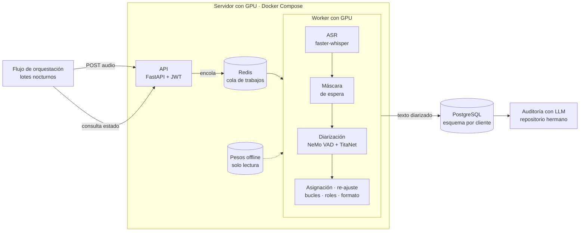

# Transcripción diarizada de llamadas con IA

Servicio que recibe el audio de una llamada de contact center y devuelve **quién dijo qué y cuándo**: transcribe con Whisper (faster-whisper sobre CTranslate2), separa a los dos hablantes con NVIDIA NeMo y etiqueta cada turno como `AGENTE` o `CLIENTE`. Corre en contenedores sobre un servidor propio con GPU y alimenta el pipeline de auditoría de calidad con LLM descrito en el [repositorio hermano](https://github.com/fyamith01/analisis-llamadas-ia_exhibicion).

> [!IMPORTANT]
> Este repositorio es una **exhibición técnica**. El servicio real es propiedad de la empresa para la que lo construí y no se publica.
> Aquí no hay código, audios, nombres ni configuraciones de esa empresa: hay diagramas, decisiones de diseño, mediciones redondeadas y un **ejemplo ejecutable escrito desde cero con llamadas inventadas**. Ver [AVISO.md](AVISO.md).

## En 30 segundos

| Pregunta | Respuesta |
|---|---|
| ¿Qué problema resuelve? | Una llamada es un audio **mono**: el texto plano de Whisper mezcla al agente y al cliente. Para auditar al agente hay que saber qué dijo cada uno. |
| ¿Qué entrega? | Una línea por llamada: `[00:00] AGENTE: … [00:06] CLIENTE: …`. Lo que no se puede atribuir sale como `HABLANTE_?`, sin perder texto. |
| ¿Cómo sabe quién es el agente? | Por lo que dice: el hablante que pronuncia el **saludo de la operación** es el agente. Si nadie lo dice, no adivina. |
| ¿Dónde corre? | API + worker + Redis en **Docker**, en un servidor Ubuntu con una GPU de 16 GB que comparte con el análisis LLM en **ventanas nocturnas**. |
| ¿Qué pasa si algo sale mal? | Cada mejora tiene su **interruptor por variable de entorno**. Volver al texto plano anterior es cambiar una variable y recrear el worker. |
| ¿Cómo se construyó? | Con un **flujo de desarrollo multiagente** (Claude Code como orquestador, subagentes, memoria persistente y MCP) dirigido y verificado por mí. |

## Arquitectura general



## Stack

| Capa | Herramientas |
|---|---|
| Servicio | Python 3.12, FastAPI, JWT, RQ sobre Redis 7, PostgreSQL |
| Voz | faster-whisper / CTranslate2 (`large-v3-turbo`), VAD Silero, NVIDIA NeMo (VAD MarbleNet + embeddings TitaNet + clustering espectral), PyAV |
| Infraestructura | Docker Compose, imagen CUDA 12 + cuDNN 9, NVIDIA Container Toolkit, `uv` con lockfile |
| Calidad | pytest sin GPU (modelos falsos inyectables), benchmark propio de velocidad, VRAM y texto |
| Desarrollo asistido | Claude Code, subagentes, MCP, memoria persistente (Engram), flujo ODD |

## Documentación

| # | Documento | Qué vas a encontrar |
|---|---|---|
| 1 | [Arquitectura](docs/01-arquitectura.md) | API, worker y Redis; contrato HTTP; ciclo de vida de un trabajo y salud del worker |
| 2 | [El núcleo de voz](docs/02-nucleo-de-voz.md) | ASR, diarización, máscara de espera, asignación, re-ajuste por puntuación, bucles, roles y formato |
| 3 | [Despliegue y operación](docs/03-despliegue-y-operacion.md) | Contenedores, pesos offline, GPU compartida, benchmark de velocidad frente a calidad y rollback |
| 4 | [Desarrollo con sistemas multiagente](docs/04-desarrollo-multiagente.md) | Orquestador, subagentes, ODD, memoria y MCP aplicados a este servicio |
| 5 | [De punta a punta](docs/05-de-punta-a-punta.md) | Cómo este servicio alimenta el pipeline de auditoría del repositorio hermano |
| 6 | [Lecciones aprendidas](docs/06-lecciones-aprendidas.md) | Los problemas reales que encontramos y la regla que dejó cada uno |

## Probar el ejemplo

El ejemplo reproduce la lógica posterior a los modelos (máscara, re-ajuste, bucles, roles y formato) sobre llamadas **inventadas**. No necesita GPU, Docker ni dependencias.

```bash
cd ejemplo
uv run diarizar.py                     # 3 llamadas sintéticas, salida diarizada
MASCARA_ESPERA=off uv run diarizar.py  # el fallo que corrige la máscara
uv run pruebas.py                      # 16 pruebas unitarias
```

Detalles en [ejemplo/README.md](ejemplo/README.md).

## Repositorio relacionado

| Repositorio | Papel |
|---|---|
| **Este** | Convierte audio en texto diarizado `AGENTE` / `CLIENTE` |
| [analisis-llamadas-ia_exhibicion](https://github.com/fyamith01/analisis-llamadas-ia_exhibicion) | Lee ese texto desde PostgreSQL, audita cada conversación con un LLM y produce el informe mensual |

El recorrido completo, con el reparto de la GPU entre los dos, está en [De punta a punta](docs/05-de-punta-a-punta.md).

## Mi rol

Diseñé la versión diarizada del servicio, calibré sus umbrales con llamadas reales, medí el costo de cada configuración en el servidor y decidí qué se priorizaba. Los asistentes de IA escribieron buena parte del código **bajo mi dirección**: yo fijé el alcance, revisé cada cambio y validé cada resultado en el servidor antes de que llegara a producción.

## Licencia

[MIT](LICENSE). Cubre la documentación y el ejemplo de este repositorio, no el servicio original (ver [AVISO.md](AVISO.md)).
