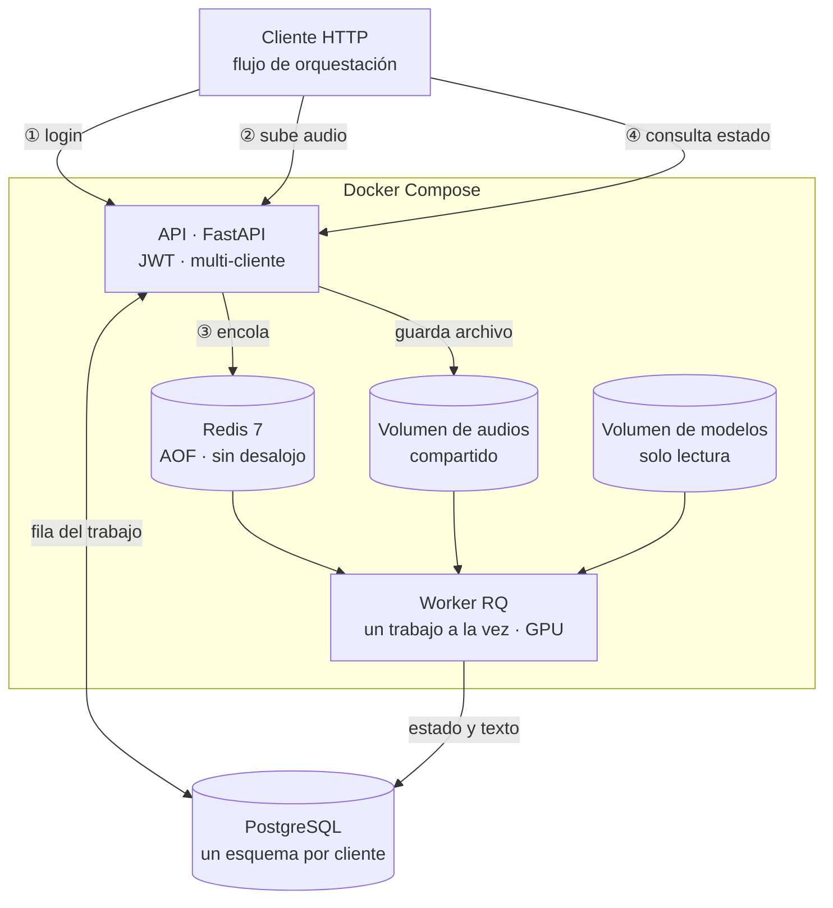
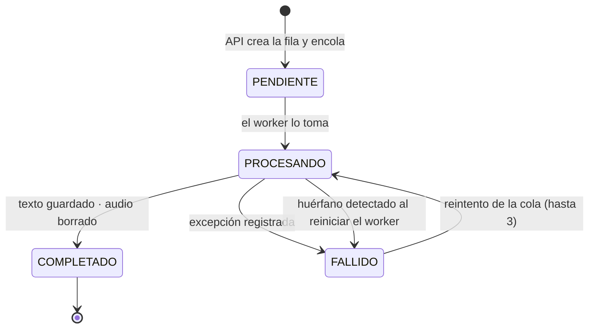

# 1. Arquitectura

**Tres contenedores con responsabilidades separadas: la API recibe y responde rápido, Redis guarda la cola y un único worker con GPU hace el trabajo pesado.** El contrato HTTP de la primera versión se conservó intacto, así que la versión diarizada pudo reemplazarla sin cambiar a quien la consume.

## Vista de componentes



| Componente | Responsabilidad | Decisión clave |
|---|---|---|
| **API** | Autenticar, validar, guardar el audio, crear la fila y encolar | Nunca transcribe: responde en milisegundos aunque la GPU esté ocupada |
| **Redis** | Cola de trabajos y señales del worker | Persistencia AOF y política *sin desalojo*: un trabajo encolado no se pierde por falta de memoria |
| **Worker** | Transcribir, diarizar y escribir el resultado | Un solo proceso con los modelos residentes en VRAM, sin `fork` |
| **PostgreSQL** | Fila por audio con su estado y su texto | Cada cliente tiene su propio esquema; la API lo resuelve a partir de una clave de cliente |

## Contrato HTTP

Las rutas y campos son **ilustrativos**; la forma es la del servicio.

| Método y ruta | Qué hace | Respuesta |
|---|---|---|
| `POST /auth/login` | Usuario y contraseña | Token JWT (bearer) |
| `POST /transcripciones?cliente=<clave>` | Sube un audio (`multipart/form-data`) | `201` con `job_id` y la fila creada en estado `PENDIENTE` |
| `GET /transcripciones/{job_id}` | Estado del trabajo (solo su dueño o un admin) | `estado`, `texto`, `error` |
| `GET /transcripciones?cliente=<clave>` | Historial del usuario, del más reciente al más antiguo | Lista de filas |

Ejemplo de respuesta de estado, con datos inventados:

```json
{
  "job_id": "0f3c9a8e-1d2b-4c5e-9f00-123456789abc",
  "estado": "completed",
  "texto": "[00:00] AGENTE: Gracias por llamar a Línea Demo... [00:06] CLIENTE: Hola, buenas tardes...",
  "error": null
}
```

Reglas que el contrato garantiza:

- **El cliente se valida antes de encolar.** Si el usuario no tiene permiso sobre esa clave, o el cliente no tiene esquema, la petición falla con un código claro y no se crea nada.
- **Si el encolado falla, el audio se borra.** No quedan archivos huérfanos en disco.
- **Los metadatos del cliente viajan con el trabajo**, de modo que la consulta de estado funciona incluso si el worker lo toma antes de que la API termine de responder.
- **El formato del texto es el único cambio** entre la versión plana y la diarizada. Quien consume el servicio no tuvo que cambiar ni rutas ni autenticación.

## Ciclo de vida de un trabajo



| Parámetro de la cola | Valor | Motivo |
|---|---|---|
| Reintentos | 3 | Un fallo transitorio de GPU o de red no pierde el audio |
| Tiempo máximo por trabajo | 30 min | Muy por encima del peor caso real (decenas de segundos) |
| Resultados en Redis | 1 día | El estado definitivo vive en PostgreSQL |
| Fallos en Redis | 7 días | Margen para diagnosticar |

## Salud del worker

Un worker de GPU puede quedar **vivo pero inútil**: con los modelos sin cargar o colgado dentro de código nativo, donde las alarmas de Python no llegan. Por eso la salud no se mide con "el proceso existe", sino con señales que el propio worker publica en Redis:

| Señal | El worker la escribe… | El healthcheck falla si… |
|---|---|---|
| Modelos cargados | al terminar la carga, antes de aceptar trabajos | no existe |
| Trabajo en curso | al empezar cada trabajo, con su hora de inicio | un trabajo lleva más de 10 minutos |
| Latido en reposo | periódicamente mientras espera | lleva más de 15 minutos sin latir |

Además:

- **Al arrancar, el worker reconcilia.** Las filas que quedaron en `PROCESANDO` y cuyo trabajo ya no existe en la cola se marcan como fallidas. Ningún audio queda "procesando" para siempre.
- **Se reinicia solo cada N trabajos** (500 por defecto). Es la única forma garantizada de devolver toda la VRAM que reserva CTranslate2; Docker lo levanta de nuevo con `restart: always`.
- **Un único proceso, sin `fork`.** CUDA no sobrevive a un `fork` y cargar los modelos en cada trabajo costaría más que el trabajo mismo.

## Siguiente

[2. El núcleo de voz →](02-nucleo-de-voz.md)
