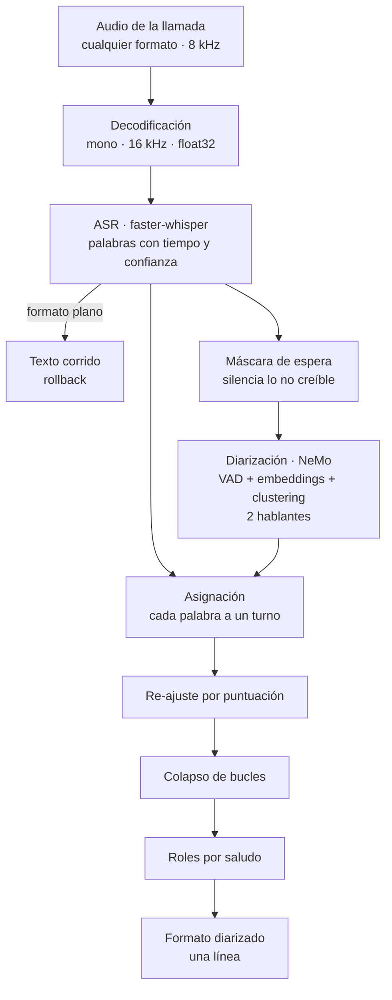
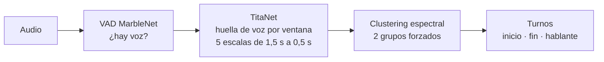
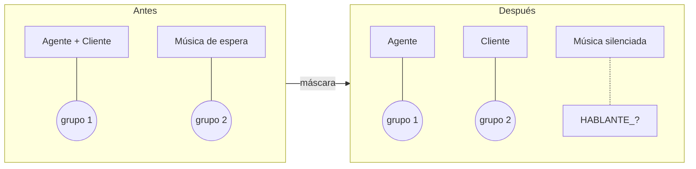

# 2. El núcleo de voz

**Dos modelos y cinco reglas deterministas.** Whisper transcribe con marcas de tiempo por palabra, NeMo decide qué tramos de audio pertenecen a cada uno de los dos hablantes, y después unas reglas pequeñas, medibles y con interruptor propio reparan lo que los modelos dejan mal: la música de espera, los cambios de turno corridos, los bucles del ASR y la identidad de cada hablante.

## El recorrido de un audio



| Paso | Qué hace | Interruptor (nombre ilustrativo) |
|---|---|---|
| ASR | Transcribe con tiempo por palabra | `FORMATO=plano` termina aquí |
| Máscara de espera | Silencia música y ruido antes de diarizar | `MASCARA_ESPERA`, `MASCARA_UMBRAL` |
| Diarización | Separa 2 hablantes | — |
| Asignación | Une palabras y turnos | — |
| Re-ajuste | Mueve hasta 2 palabras en un cambio de turno | `REAJUSTE` |
| Bucles | Recorta repeticiones patológicas | `COLAPSO_BUCLES` |
| Roles | `AGENTE` / `CLIENTE` por el saludo | `REGLAS_SALUDO` |

Toda la configuración se **valida antes de tocar la GPU**: un valor inválido hace fallar el arranque del worker, no el trabajo número 300.

## ASR: el mismo Whisper, otro motor

La primera versión usaba `whisper-large-v3-turbo` con HF transformers en trozos fijos de 30 s. La versión diarizada usa **los mismos pesos convertidos a CTranslate2** y ejecutados con faster-whisper.

| Opción | Valor | Por qué |
|---|---|---|
| Precisión | `float16` (alternativa `int8_float16`) | Calidad primero; ver el [benchmark](03-despliegue-y-operacion.md#benchmark-velocidad-frente-a-calidad) |
| Haces | 5 (configurable de 1 a 10) | Con 1 haz se perdían frases enteras |
| Idioma | Español fijo | Evita detecciones erróneas en saludos cortos |
| Marcas de tiempo por palabra | Sí | Son la base de todo lo que viene después |
| VAD Silero | Silencios de 500 ms o más | Corta por pausas reales y no en mitad de una frase, como los trozos fijos de 30 s |
| Condicionar en el texto previo | No | Reduce los bucles que se propagan de un segmento al siguiente |

Cada palabra sale con inicio, fin, texto y la **confianza media (`avg_logprob`) de su ventana** de Whisper. Esa confianza es la que usa la máscara de espera.

## Diarización con NeMo

Diarizar es responder "¿quién habla cuándo?" sin saber quiénes son. NeMo lo hace en tres pasos:



- **Dos hablantes forzados.** Una llamada de contact center tiene agente y cliente; dejar que el algoritmo estime el número producía grupos espurios.
- **La ventana más fina es de 0,5 s.** Los tiempos de palabra de Whisper se corren 0,1–0,3 s. Juntas, esas dos imprecisiones hacen que un cambio de turno caiga 1–2 palabras corrido. De ahí sale el re-ajuste por puntuación.
- **Directorio temporal por trabajo** y liberación de la caché de CUDA al terminar, para que la memoria de un trabajo no se herede al siguiente.

## Máscara de espera

**Problema.** Con 2 hablantes forzados, en una llamada con espera larga la música y las voces de fondo formaban uno de los dos grupos, y el agente y el cliente quedaban **juntos en el otro**. La transcripción entera salía atribuida a una sola persona.

**Solución.** Antes de diarizar, se pone en cero todo el audio que no esté cubierto por palabras *creíbles* de Whisper:

| Criterio de palabra creíble | Por qué |
|---|---|
| Dura 1,5 s o menos | Sobre música, Whisper produce "palabras" de varios segundos |
| Su ventana tiene `avg_logprob` ≥ −0,5 | En la espera, Whisper alucina con baja confianza |

Cada palabra creíble se amplía 0,25 s por lado y se rellenan los huecos de menos de 1 s, para no cortar la voz real en pedazos.



- **Solo cambia lo que oye NeMo.** La transcripción conserva todas las palabras; las de la espera suelen salir como `HABLANTE_?`.
- **Calibración con evidencia.** En el set de prueba, las ventanas de espera iban de −0,50 a −1,2 y las de conversación real de −0,12 a −0,56: se solapan. Con −0,6 la llamada con espera volvió a mezclar a los hablantes; con −0,5 algunas ventanas reales pierden su hablante, **sin perder texto**. Se eligió el costo menor.
- **Salvaguarda.** Si ninguna palabra es creíble, NeMo recibe el audio original: es mejor oír todo que no oír nada.

## Asignación de palabras a turnos

Cada palabra va al turno con el que **más se solapa en el tiempo**. Si no toca ninguno, va al turno más cercano a 0,5 s o menos. Si tampoco, queda como `HABLANTE_?`. Las palabras consecutivas del mismo hablante forman un turno.

## Re-ajuste de turnos por puntuación

Cuando un cambio de turno cae en mitad de una frase, la salida queda así:

```text
CLIENTE: … de un pedido. ¿Me regala  AGENTE: el número de pedido, por favor?
```

El re-ajuste **solo actúa** si el turno nuevo empieza en minúscula y el anterior no termina en `. ? ! …`. Entonces:

| Regla | Qué mueve | Ejemplo |
|---|---|---|
| **1** | La cola del turno anterior, desde su último inicio de frase, pasa al turno nuevo | `¿Me regala` pasa al agente |
| **2** | Si la regla 1 no aplica, la cabeza del turno nuevo, hasta su primer fin de frase, vuelve al anterior | `tarde.` vuelve al agente |

Inicio de frase es `¿`, `¡`, una mayúscula en una palabra sin dígitos o la palabra que sigue a `. ? ! …`. Límites: **nunca más de 2 palabras**, nunca deja un turno vacío y nunca mueve palabras sin hablante.

- **Medido en seco** sobre el set de prueba: unas 70 correcciones, de las que unas 60 mejoraban el texto.
- **Costo conocido:** una respuesta corta real sin puntuación ("correcto", "así es") puede pasar al otro hablante. Por eso tiene interruptor.

## Colapso de bucles del ASR

Whisper a veces repite un token dentro de un segmento, típicamente al dictar letras o cifras: `U, U, U, U, …` cuarenta veces. Si una unidad de **1 a 4 palabras** se repite **5 o más veces seguidas** (sin distinguir mayúsculas, tildes ni puntuación), quedan solo las 3 primeras.

El umbral sale de medir: en el set de prueba, el habla real repite como mucho 4 veces (`sí, sí, sí, sí`). Se aplica solo al texto diarizado, después del re-ajuste, y el log del worker cuenta cuántos bucles recortó.

## Roles por saludo

Una llamada mono no dice quién es quién. Pero el agente **siempre se presenta** con una fórmula de la operación. Esa es la señal:

```text
regla1 | regla2 | frase_a + frase_b | …
```

- `|` separa reglas, que se prueban **en orden**.
- `+` une frases que **el mismo hablante** debe decir en la llamada (en cualquier punto).
- Se ignoran mayúsculas, tildes y puntuación, y se buscan palabras completas.
- Gana la **primera regla que se cumple**. Quien la dijo es `AGENTE`; el otro, `CLIENTE`.
- Si no se cumple ninguna, **no se adivina**: los hablantes salen como `speaker_1`, `speaker_2` por orden de aparición.

Familias de reglas (las frases reales de cada operación no se publican):

| Familia | Ejemplo inventado |
|---|---|
| Agradecimiento por llamar | `gracias por llamar a` |
| Bienvenida | `le damos la bienvenida a` |
| Presentación del asesor | `mi nombre es` |
| Llamadas salientes, sin bienvenida | `estoy buscando a + le llamo de` |

Dos decisiones que salieron de las llamadas reales:

- **Funciona aunque el cliente hable primero.** En una saliente, el cliente contesta "¿Aló?" antes de que el agente se presente; la regla busca en toda la llamada, no en la primera frase.
- **Las reglas compuestas evitan falsos positivos.** Algunas frases de presentación también las dice un cliente que llama (en el ejemplo, "estoy buscando a…"); exigir una segunda frase propia del agente vuelve segura la regla.

## Formato de salida

Una sola línea por llamada, pensada para que la lea **un LLM** en la etapa siguiente:

```text
[00:00] AGENTE: Gracias por llamar a Línea Demo, le atiende Camila. [00:06] CLIENTE: Hola, buenas tardes. [00:21] HABLANTE_?: Gracias por ver el video.
```

| Elemento | Regla |
|---|---|
| Marca de tiempo | `[mm:ss]`; desde una hora, `[h:mm:ss]` |
| Etiquetas | `AGENTE`, `CLIENTE`, `speaker_N` o `HABLANTE_?` |
| Turnos contiguos con la misma etiqueta | Se unen |
| Rollback | `FORMATO=plano` devuelve el texto corrido de la versión anterior y ni siquiera carga NeMo |

## Pruébalo

Todo lo que viene después de los modelos está reimplementado desde cero, con llamadas inventadas, en [`ejemplo/`](../ejemplo/README.md). Cada interruptor de esta página tiene su equivalente allí.

## Siguiente

[3. Despliegue y operación →](03-despliegue-y-operacion.md)
