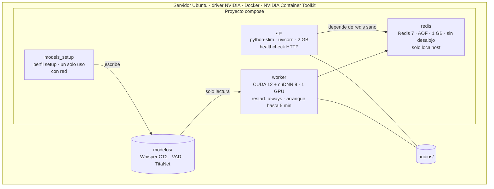
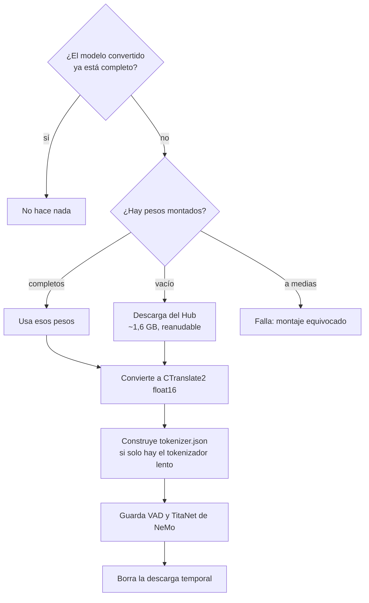
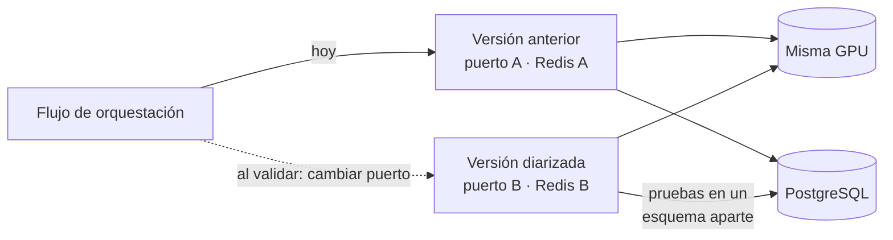

# 3. Despliegue y operación

**El servicio se despliega con un solo `docker compose`, sin red en el worker y con los pesos montados en solo lectura.** La versión diarizada corrió primero en paralelo a la anterior, en el mismo servidor y la misma GPU, y la decisión de qué configuración usar salió de un benchmark propio, no de la intuición.

## Contenedores



| Servicio | Detalle que importa |
|---|---|
| `redis` | Publicado solo en `localhost`. Con *sin desalojo*, si se llena rechaza escrituras en vez de borrar trabajos |
| `api` | Arranca solo cuando Redis está sano. Imagen liviana, sin CUDA |
| `worker` | La imagen trae CUDA y cuDNN: el host solo aporta el driver. Dependencias fijadas con `uv.lock`. Arranca en modo offline |
| `models_setup` | Detrás de un perfil: `docker compose up` no lo levanta. Es el único servicio con red y con escritura sobre los modelos |

## Pesos offline

El worker de producción **no descarga nada**: si un modelo falta, falla al arrancar con un mensaje claro. La preparación es un paso explícito, de una sola vez:

```bash
docker compose build
docker compose --profile setup run --rm models_setup   # descarga y convierte
docker compose run --rm worker python3 prueba_gpu.py   # carga todo y procesa un audio corto
docker compose up -d                                   # los tres servicios deben quedar healthy
```



- **Idempotente.** Repetirlo no rehace lo que ya está completo y retoma una descarga cortada.
- **Se niega a mezclar.** Una conversión interrumpida no se "completa" encima: hay que borrarla y repetir. Un modelo a medias es peor que ninguno.
- **Reutiliza los pesos de la versión anterior** si se montan, sin tocar la red: la comparación entre versiones usa exactamente el mismo modelo.

## GPU compartida con el análisis LLM

El mismo servidor tiene **una GPU de 16 GB** para dos cargas: esta transcripción y el análisis con LLM del [repositorio hermano](https://github.com/fyamith01/analisis-llamadas-ia_exhibicion). Durante un trabajo, la diarización y el ASR necesitan varios GB por encima de los pesos, y el LLM con concurrencia 2 ocupa unos 9 GB. **Juntos no caben**, así que se reparten el día:

```mermaid
gantt
    title Uso de la GPU en 24 horas
    dateFormat HH:mm
    axisFormat %H:%M
    section LLM
    Auditoría con LLM               :a1, 06:00, 18h
    section Corte
    se detiene el LLM (checkpoint)  :milestone, 00:30, 0m
    section Transcripción
    Lotes de audio diarizados       :w1, 00:30, 330m
    section Reanudación
    se reanuda el LLM               :milestone, 06:00, 0m
```



| Medida | Para qué |
|---|---|
| El LLM se detiene con checkpoint antes de la ventana | La transcripción tiene la GPU para ella sola |
| El worker solo retiene los pesos en reposo (~2,4 GB) | La memoria de cada trabajo se devuelve al terminarlo |
| El worker se reinicia cada 500 trabajos | Libera la VRAM que CTranslate2 no devuelve por sí mismo |
| El pico no crece con la duración del audio | NeMo parte el audio largo: 7 minutos y 30 minutos cuestan lo mismo en memoria |

## Benchmark: velocidad frente a calidad

Un script propio corre **dentro de la imagen de cada versión**, sobre la misma carpeta de audios, sin cola ni base de datos. Descarta el primer audio (carga y calentamiento), cronometra el resto y muestrea la VRAM de toda la GPU antes de cargar, después de cargar, en el pico y en reposo. Un subcomando genera la comparación en Markdown con muestras de texto lado a lado.

Set de prueba: 12 llamadas de 7 a 30 minutos. Cifras redondeadas.

### Versión anterior frente a la diarizada

| | Texto plano (anterior) | Diarizada |
|---|---|---|
| Segundos por audio (media) | ~9 | ~18 |
| VRAM extra en el pico | ~2 GB | ~8 GB |
| Errores | 0 de 12 | 0 de 12 |

Tarda unas **2 veces más**, pero el reparto lo explica (en una llamada de ~8 minutos: ~10 s de ASR y ~5 s de diarización) y la ganancia de calidad es grande: la versión anterior perdía frases en los cortes de 30 s y entraba en bucles largos ("Sí." unas 300 veces) en 4 de 5 muestras.

### Tres configuraciones del ASR

| | A · 5 haces, float16 | B · 1 haz, float16 | C · 1 haz, int8 |
|---|---|---|---|
| Tiempo medio | referencia (~17 s) | −9 % | −20 % |
| VRAM en el pico | referencia | −0,35 GB | −1 GB |
| Bucles | ninguno | ninguno | ninguno |
| Frases completas perdidas | — | sí | sí |
| Mayúsculas y puntuación | bien | bien | se pierden en tramos largos |

Sin transcripciones de referencia no se puede calcular el WER, así que la calidad se juzgó **comparando textos**: con 1 haz desaparecían preguntas completas del agente y, en C, al perderse la puntuación se juntaban turnos (19 turnos con roles frente a 26). Como el re-ajuste por puntuación y la auditoría posterior dependen justamente de la puntuación y de las frases del agente, **se mantuvo A**. Un modo por lotes más rápido se descartó porque omite las protecciones contra bucles.

> [!NOTE]
> Lección de método: la configuración rápida se llegó a activar por defecto y se revirtió tras ver los textos. Una cifra de velocidad sin una muestra de calidad al lado no basta para decidir.

## Despliegue en paralelo y rollback



- **Convivencia.** Cada versión tiene su proyecto compose, su puerto y su Redis. Las pruebas de la diarizada escriben en un esquema propio.
- **Cambio de versión.** Como el contrato HTTP es el mismo, pasar a la diarizada es cambiar el puerto en el flujo de orquestación.
- **Rollback en tres niveles:**

| Nivel | Cómo | Efecto |
|---|---|---|
| Una mejora | Su interruptor en `off` y `docker compose up -d worker` | Solo esa regla deja de aplicarse |
| Formato | `FORMATO=plano` | Texto de la versión anterior; NeMo ni se carga |
| Versión completa | `docker compose down` de la diarizada | El flujo sigue en la anterior, que nunca se tocó |

## Pruebas

| Dónde | Qué |
|---|---|
| Local, sin GPU | pytest con modelos falsos inyectables: ASR, audio, diarización, máscara, asignación y re-ajuste, bucles, roles, formato, orquestación e interruptores, coherencia del compose con los valores por defecto, preparación de pesos y arranque del worker. Unas 190 pruebas |
| Servidor, con GPU | Prueba de GPU (carga real y un audio corto, código de salida 1 si algo falla) y el benchmark |
| Herramientas de calibración | Un volcado de la diarización que aplica la máscara y el re-ajuste **en seco**, con las mismas funciones del worker, para ver qué cambiaría antes de tocar producción |

## Siguiente

[4. Desarrollo con sistemas multiagente →](04-desarrollo-multiagente.md)
