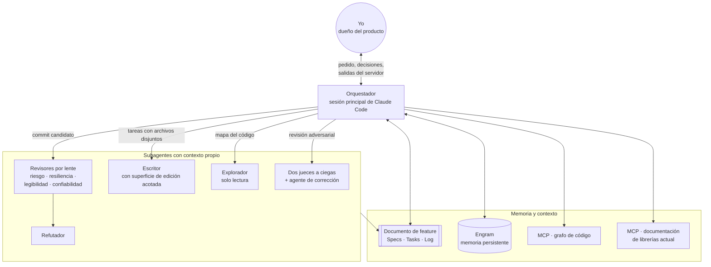
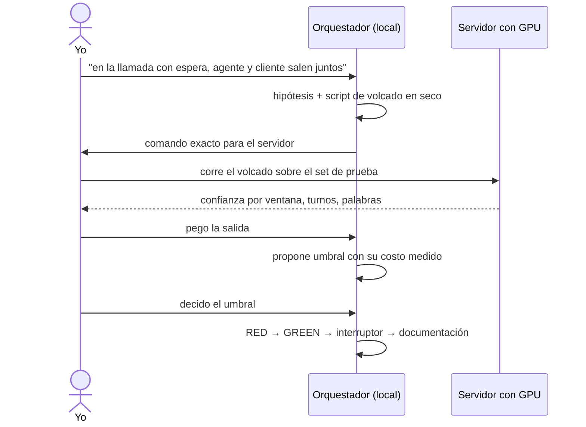

# 4. Desarrollo con sistemas multiagente

**La versión diarizada la construí dirigiendo el mismo equipo de agentes que usé en el [repositorio hermano](https://github.com/fyamith01/analisis-llamadas-ia_exhibicion/blob/main/docs/04-desarrollo-multiagente.md)**: una sesión de Claude Code que orquesta, subagentes con roles acotados, memoria persistente y servidores MCP. Lo distinto aquí fue el peso de las **pruebas primero** y de la **medición en el servidor**: casi cada regla del núcleo de voz nació de una evidencia que yo traje del servidor y se escribió con una prueba en rojo antes que con código.

## La topología



| Rol | Qué aportó en este servicio |
|---|---|
| **Orquestador** | Partió el trabajo en tareas, eligió la ruta de cada una y mantuvo el documento de la feature al día |
| **Explorador** | Mapas del código en solo lectura. La primera tarea importó tal cual la versión anterior (API, cola, worker, healthcheck) para conservar el contrato antes de cambiar el núcleo |
| **Escritor** | Tareas con archivos disjuntos, siempre con la prueba que las demostraba |
| **Revisores y refutador** | Configurados en el proyecto para revisar un commit candidato por lentes; el refutador intenta tumbar cada hallazgo antes de que bloquee |
| **Jueces a ciegas** | También configurados: dos revisores independientes que no ven el razonamiento del otro; un tercer agente aplica solo lo que ambos confirman |
| **MCP · documentación** | API vigente de faster-whisper, NeMo y RQ, en lugar de lo que el modelo recordaba |
| **MCP · grafo de código** | Radio de impacto de un cambio (quién llama a qué) sin leer archivo por archivo |

## ODD: dos features, una regla por evidencia

El trabajo se organizó con **ODD (Organic Driven Development)**: todo pedido pasa por autorizar, explorar, resolver dudas y clasificar; lo grande lleva un documento de feature antes de escribir código. Aquí hubo dos:

| Feature | Tareas | Qué cubrió |
|---|---|---|
| Núcleo diarizado | 17 | Base de la versión anterior, imagen CUDA, audio, ASR, diarización, asignación, formato, roles, fachada de inferencia, worker, esquema de pruebas y benchmark, documentación, y después las mejoras: máscara de espera, re-ajuste, bucles, reglas de saludo calibradas |
| Roles y velocidad | 6 | Frases de saludo medidas, haces configurables, modo por lotes (evaluado y descartado), benchmark A/B/C, vuelta a la configuración de calidad y nuevo comportamiento sin coincidencia |

Cada tarea registra su **evidencia** en la tabla, por ejemplo:

```markdown
| T6 | S4 | merge: palabras → hablante por solape máximo | inline (TDD) | hecho | RED: import error → GREEN 7 passed |
| T4 | S6 | Benchmark A/B/C en el servidor            | lo corre el usuario | hecho | tabla en la guía de operación |
```

### Pruebas primero, de verdad

El modo TDD estaba activado para el proyecto. Para cada módulo puro (audio, asignación, formato, roles, máscara, bucles) el agente tenía que mostrar:

1. **RED**: la prueba falla por la razón esperada, con la salida observada.
2. **GREEN**: el código mínimo que la hace pasar.
3. **REFACTOR**: limpieza sin cambiar el comportamiento.

Los modelos reales no caben en una laptop sin GPU, así que **se inyectan fábricas falsas**: las pruebas recorren toda la orquestación (incluidos los interruptores) en segundos, y la ruta real en GPU se valida aparte en el servidor.

## Humano en el circuito: el servidor es mío

Los agentes **no tienen acceso al servidor, a los audios ni a las credenciales**. La calibración funcionó así:



- **El script de calibración se volvió producción.** La máscara de espera nació en una herramienta de volcado; cuando funcionó, su lógica pasó a un módulo del worker y la herramienta pasó a importarlo. Calibración y producción usan **las mismas funciones**.
- **Las decisiones de producto son mías.** Ejemplo: con 1 haz el servicio era 20 % más rápido; el agente lo activó por defecto, yo revisé los textos del benchmark y pedí volver a 5 haces. Quedó registrado como un cambio de requisito en el log de la feature, con su motivo.
- **Medir, no inferir.** Ninguna regla se dio por buena con un solo audio: el re-ajuste se midió en seco sobre todo el set antes de activarse.

## Memoria persistente

Con [Engram](https://github.com/Gentleman-Programming/engram), cada sesión empezaba recuperando el contexto del proyecto en lugar de redescubrirlo:

| Se guardó | Ejemplo |
|---|---|
| Decisiones | "Calidad sobre velocidad: 5 haces y float16 por defecto" |
| Causas de errores | "El latido de RQ no se refresca durante un trabajo en el worker sin fork" |
| Restricciones | "Los modelos se montan en solo lectura; el worker arranca sin red" |
| Copia del documento de feature | Para retomar la tarea exacta tras cerrar la sesión |

## Este repositorio

Esta exhibición también se escribió con el flujo: un explorador leyó el proyecto original **en solo lectura** y devolvió una descripción conceptual, el orquestador escribió los documentos y el ejemplo desde cero, y el cierre incluyó un escaneo de privacidad con `grep` y la comprobación de que el proyecto original seguía sin cambios.

## Siguiente

[5. De punta a punta →](05-de-punta-a-punta.md)
