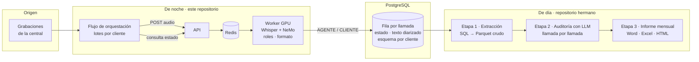
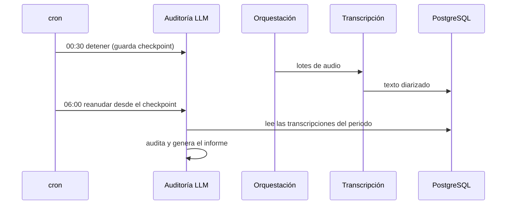

# 5. De punta a punta

**Este servicio es la primera mitad de un sistema de dos partes.** Convierte cada llamada en texto diarizado; un flujo de orquestación lo guarda en PostgreSQL, y de ahí lo lee el pipeline de auditoría con LLM descrito en el [repositorio hermano](https://github.com/fyamith01/analisis-llamadas-ia_exhibicion). Los dos comparten el mismo servidor y la misma GPU, en turnos.

## El recorrido completo

| Tramo | Quién | Qué cruza | Enlace |
|---|---|---|---|
| Grabación → servicio | Flujo de orquestación | Audio por HTTP, por lotes | [Contrato HTTP](01-arquitectura.md#contrato-http) |
| Servicio → PostgreSQL | Worker | Una fila por llamada con el texto diarizado | [Formato de salida](02-nucleo-de-voz.md#formato-de-salida) |
| PostgreSQL → auditoría | Etapa 1 del hermano | SQL a Parquet crudo | [Datos y almacenamiento](https://github.com/fyamith01/analisis-llamadas-ia_exhibicion/blob/main/docs/02-datos-y-almacenamiento.md) |
| Auditoría | Etapa 2 del hermano | Cada conversación al LLM con una matriz de calidad | [La IA en el pipeline](https://github.com/fyamith01/analisis-llamadas-ia_exhibicion/blob/main/docs/03-ia-en-el-pipeline.md) |

## Por qué la diarización importa aguas abajo

La auditoría califica **al agente**: si saludó, si verificó la identidad, si ofreció una solución. Con texto plano, el LLM tenía que adivinar quién decía cada frase.

| Con texto plano | Con texto diarizado |
|---|---|
| "¿Me confirma su documento?" ¿lo pidió el agente o lo preguntó el cliente? | `AGENTE: ¿Me confirma su documento?` |
| Una frase del cliente podía contar como cumplimiento del agente | Solo cuentan los turnos `AGENTE` |
| Las citas de evidencia no decían quién habló | La cita trae rol y minuto: `[03:12] AGENTE: …` |
| Frases perdidas en los cortes de 30 s | Cortes por pausas reales de voz |

Por eso el formato se diseñó **para un lector LLM**: una sola línea, etiquetas en mayúsculas fáciles de citar, marcas de tiempo cortas y un `HABLANTE_?` explícito en lugar de una atribución inventada.

## Un solo servidor, dos turnos

- **La frontera es la base de datos.** Los dos sistemas no se llaman entre sí: se coordinan por tablas y por horario. Uno puede fallar, reintentarse o cambiarse de versión sin que el otro lo note.
- **Contingencia.** Si una noche no se transcribió un periodo, un script del lado de la auditoría reenvía al servicio los audios pendientes, descarta los ya transcritos y sigue. Ver [Despliegue y operación del hermano](https://github.com/fyamith01/analisis-llamadas-ia_exhibicion/blob/main/docs/05-despliegue-y-operacion.md#flujo-de-contingencia).
- **El mismo patrón de reparto de GPU** está descrito desde el otro lado en el [presupuesto de VRAM del hermano](https://github.com/fyamith01/analisis-llamadas-ia_exhibicion/blob/main/docs/05-despliegue-y-operacion.md#presupuesto-de-vram).

## Siguiente

[6. Lecciones aprendidas →](06-lecciones-aprendidas.md)
